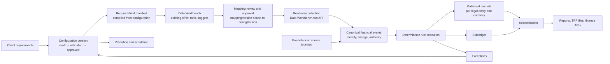

# 00 — Overview

## Purpose

An independent, configuration-driven insurance General Ledger. A client delivers accounting and reporting requirements; the implementation team (BA) turns them into **versioned, approved configuration**; finance reviews; a **deterministic engine** executes. New client scenarios are new configuration and regression tests, never new modules or hardcoded SQL ([ADR-0003](adr/ADR-0003-configuration-not-modules.md)).

Two capabilities are the product. Everything else consumes them.

1. **Configuration and rule engine**: source authority, events and lifecycle, base and derived measures, dimensions and filters, dates and periods, business keys, accounting classes, chart of accounts, account assignment, posting rules, reconciliation equations.
2. **Requirements-driven insurance data identification and collection**: configuration → required-field manifest → Data Workbench discovery and mapping proposals → human approval → read-only collection → canonical events.

## End-to-end flow

## Design time vs runtime

| | Design time | Runtime |
|---|---|---|
| Who | BA / implementation team edits; an independent reviewer approves | Operator runs; the engine executes |
| What changes | Configuration versions, mapping versions | Events, journals, subledger, reconciliation results |
| Gate | Validation + simulation evidence + maker-checker approval + effective date | Only **approved, effective** configuration and mapping versions may execute |
| Mutability | Drafts editable; approved versions immutable; a change is a new version | Posted journals immutable; corrections are new linked entries |

## Units and modules (reference structure)

| Unit | Kind | Contents |
|---|---|---|
| `acme.all.all.gl.app` | Mycel app | module `gl` (Priority 1: configuration, rule engine, journals, subledger, reconciliation); module `glsource` (Priority 2: manifest intake, Data Workbench mapping, approval, collection, canonical events); a `web` module for the UI follows the core |
| `acme.all.all.gl.wfc` | Temporal worker | Long-running and resumable runs: collection batches, posting batches, reclassification triggers, period close, replay |
| `acme.all.all.gl.spec` | Specification | This folder |

Modules are pure: request handling lives in `service/logic` and is tested natively. Every module owns its own Postgres schema (= its token) and ships ordered migrations. Modules communicate only through their HTTP/JSON contracts ([02_canonical_contracts](02_canonical_contracts/specification.md)).

## Hard constraints

| Constraint | Source |
|---|---|
| Stack: Go, Svelte 5, PostgreSQL 16, Temporal; reference structure | Product owner, [ADR-0001](adr/ADR-0001-stack-and-structure.md) |
| Data Workbench is used **only through its existing APIs**; no Data Workbench changes | Product owner, [ADR-0002](adr/ADR-0002-data-workbench-existing-apis.md) |
| **No connection to any reference-platform (Siddhi) database or API**, at runtime or in tests | Product owner, [ADR-0004](adr/ADR-0004-no-reference-platform-connections.md) |
| AI proposes; it never approves or posts. Posting uses deterministic approved rules | Backlog guardrails |
| Each journal balances per legal entity and currency; balance alone does not prove completeness | Backlog guardrails |
| No silent loss: missing mapping, ambiguous formula, unknown code, duplicate event, failed control → exception | Backlog guardrails |
| Money is exact decimal; never binary floating point | [ADR-0005](adr/ADR-0005-money-and-determinism.md) |
